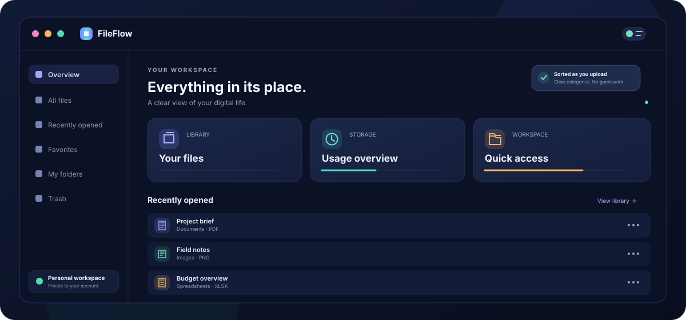

<div align="center">
  <h1>FileFlow</h1>
  <p><strong>A calmer place for all your files.</strong></p>
  <p>Upload, organize, preview, and find your files in one private workspace.</p>
  <p>
    <a href="https://fillo-file-organisor.onrender.com/"><strong>Open FileFlow</strong></a>
    &nbsp;·&nbsp;
    <a href="#run-locally">Run it locally</a>
    &nbsp;·&nbsp;
    <a href="#features">Explore features</a>
  </p>
  
  <br>
  <sub>A small preview of a more organized workspace. The illustration is local to this repository.</sub>
</div>

<br>

## A workspace that does the busywork

FileFlow is a Flask and SQLite file organizer built around a simple idea: your files should be easy to find, safe to manage, and still yours. Upload files to get automatic categories, then search, preview, favorite, tag, or move them into folders.

### Features

| Organize | Find | Stay in control |
| --- | --- | --- |
| Automatic file categories | Search, filters, and sorting | Private, per-user workspaces |
| Drag-and-drop and batch upload | Recently opened and favorites | Recoverable trash and restore |
| Duplicate detection | Image, PDF, and text previews | Safe rename and folder moves |
| Custom folders, tags, and collections | Activity history and analytics | Files are not overwritten |

Supported categories include images, documents, spreadsheets, presentations, video, audio, code, archives, and other file types. Uploads are limited to **20 MB total** and **100 files per batch**. Exact duplicates are checked with SHA-256; skipping them is optional.

### The flow

**Drop files** → **Review detected categories** → **Organize** → **Find them when you need them**

Organization creates managed copies in your FileFlow workspace. Moving a file never overwrites an existing file; a safe numbered name is chosen instead. Moving a file to Trash keeps it restorable until you explicitly choose permanent deletion.

## Built with

- **Backend:** Python, Flask, SQLite
- **Frontend:** HTML, CSS, and vanilla JavaScript
- **Authentication:** Password hashing, server-tracked sessions, email verification, and password reset
- **File safety:** Per-user storage, upload limits, supported previews, CSRF protection, and SHA-256 duplicate checks

## Run locally

```powershell
python -m pip install -r requirements.txt
python app.py
```

Open the local address printed by Flask. To enable email verification and password-reset delivery, configure either Resend or SMTP in your process environment. The values in `.env.example` are examples; Flask does **not** load that file automatically.

### Environment variables

Set a long, random `FILEFLOW_SECRET_KEY` and keep it private. Without a persistent value, signing out all sessions after a restart is expected.

| Variable | Purpose |
| --- | --- |
| `FILEFLOW_SECRET_KEY` | Flask session and token signing |
| `FILEFLOW_COOKIE_SECURE` | Set to `true` behind HTTPS |
| `FILEFLOW_DATA_DIR` | Root for SQLite data and user files |
| `FILEFLOW_DB_PATH` | SQLite database path |
| `FILEFLOW_CORS_ORIGINS` | Comma-separated allowed origins |
| `RESEND_API_KEY` | Optional Resend email delivery |
| `FILEFLOW_SMTP_HOST`, `FILEFLOW_SMTP_PORT` | Optional SMTP delivery |
| `FILEFLOW_SMTP_USERNAME`, `FILEFLOW_SMTP_PASSWORD` | SMTP authentication |
| `FILEFLOW_SMTP_FROM` | Email sender address |
| `FILEFLOW_SMTP_TLS` | Enable SMTP STARTTLS |

Resend also needs `FILEFLOW_SMTP_FROM` (or `FILEFLOW_EMAIL_FROM`) as its sender. Never commit real credentials.

## Tests

```powershell
python -m unittest discover -s tests
```

The test suite covers authentication, password recovery, per-user file access, uploads, previews, duplicate handling, file metadata, folders, trash, and CSRF enforcement.

## Deploy on Render

This repository includes a Render Blueprint in [`render.yaml`](render.yaml). Connect the repository to Render and deploy the Blueprint, then configure the email environment variables if you want account verification and password-reset messages delivered.

**Storage note:** the included free Render configuration stores data under `/tmp`, which is ephemeral. Files and SQLite data can be lost when the service restarts or redeploys. For durable production storage, use a plan with a persistent disk and set both `FILEFLOW_DATA_DIR` and `FILEFLOW_DB_PATH` to paths on that disk.

## Current scope

AI document analysis, external file sharing, file version history, and administrative user management are not implemented yet. FileFlow does not advertise or simulate these features.

---

<div align="center">
  <sub>Made for a little less file-hunting and a lot more flow.</sub>
</div>
